# Real props: photos and dimensions

The bins and packages LabelLoop sorts, measured by hand (inches, outer size) and photographed on 2026-11-20.
The sim models are built from these numbers: [`sim/qr_sort_task/props.py`](../../sim/qr_sort_task/props.py) is the source of truth
(sizes, colours sampled from these photos, poses), and [`sim/README.md`](../../sim/README.md) has the layout and cases.
Two photos are blurred in the background only (a laptop showing a chat list in `bin_black_3_side`, two people in `bin_blue_1_side`).

## Bins (open shoe boxes, lids off)

| Bin | Role | L x W x H (in) | L x W x H (mm) | Inside (mm, 5 mm modelled walls) | Outside / inside | Sim id |
|---|---|---|---|---|---|---|
| Blue (navy) | lane A: ZIP3 950, 951, 940, 941 | 14 x 8 x 5 | 356 x 203 x 127 | 346 x 193 x 122 | navy / kraft | `bin_blue` |
| Red | lane B: ZIP3 900, 901, 902 | 14 x 9.5 x 5 | 356 x 241 x 127 | 346 x 231 x 122 | red / kraft | `bin_red` |
| Black tray (shoe box LID, upside down) | reject: unknown ZIP, bad code, no label, not a parcel | 13.2 x 9.2 x 1.0 (rim) | 335 x 234 x 25 | 325 x 224 x 20 | black / white | `reject_bin` |

In the sim blue (robot-left) and red (robot-right) stand in one row on the far side of the table, length pointing away from the robot, 15 mm from
the far edge; the black reject TRAY (the black shoe box's lid used upside down, rim 1 in, so a parcel is swiped over the low rim) lies on the right side of the
table beside the right arm, 1 cm in from the right edge (y 0.4281, x 0). Sim id stays `reject_bin`; success = parcel centre inside the tray footprint, resting (z up to rim + 63.5 mm).

| Blue | Red | Black |
|---|---|---|
| 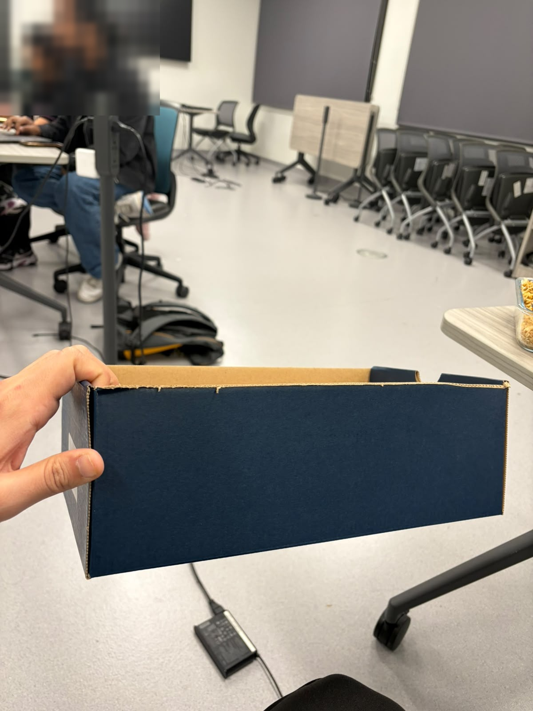 | 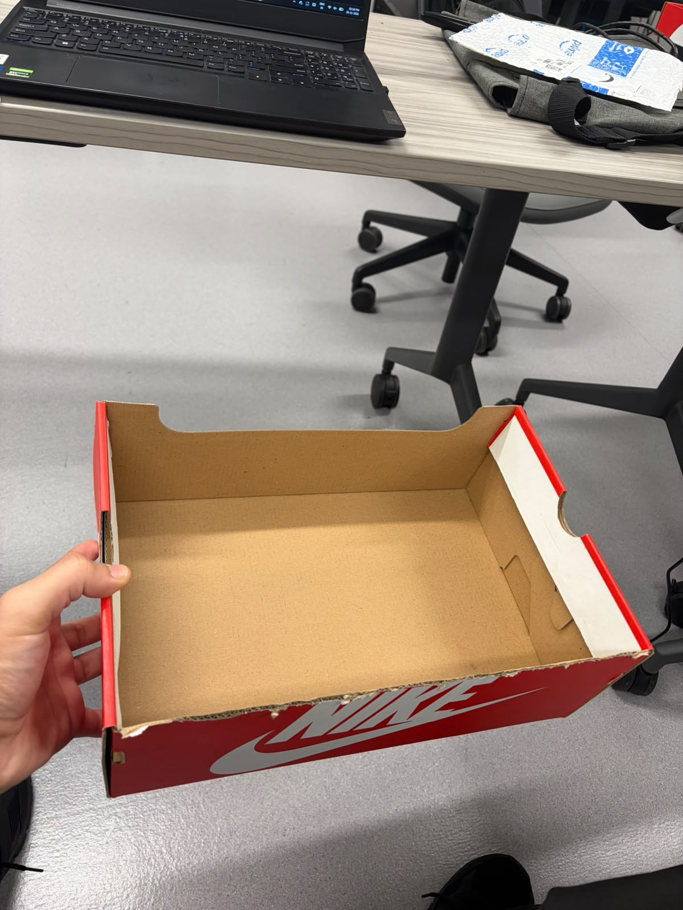 | 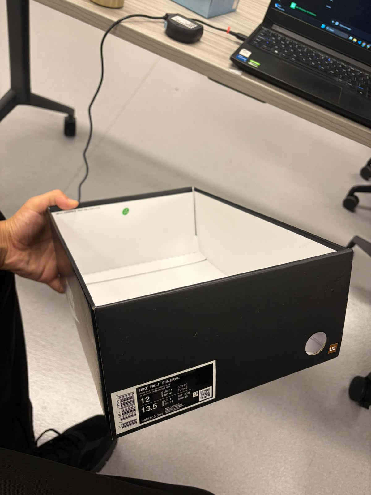 |
| 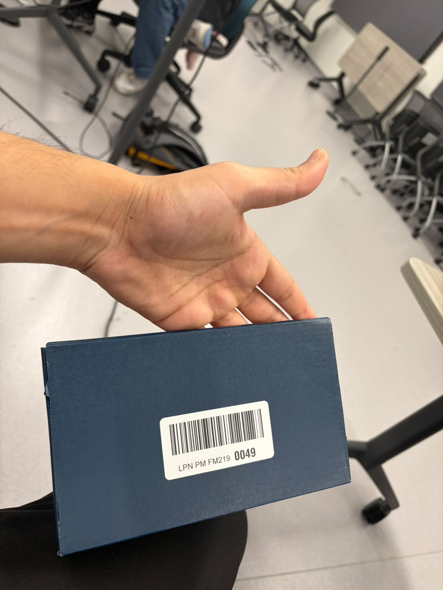 | 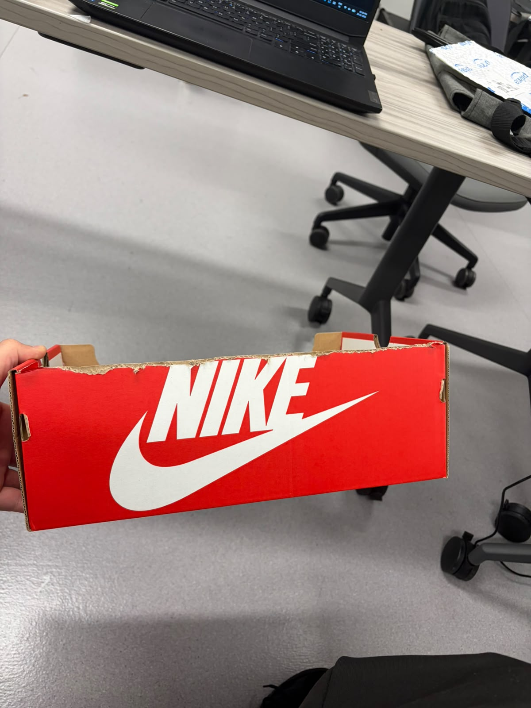 | 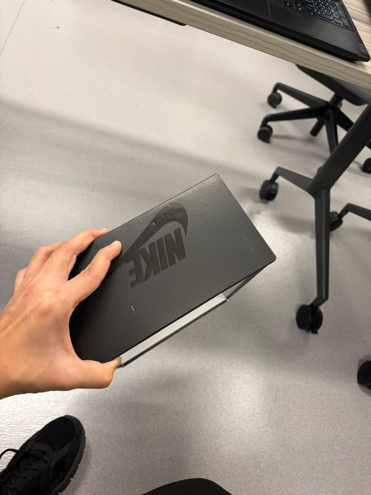 |
| 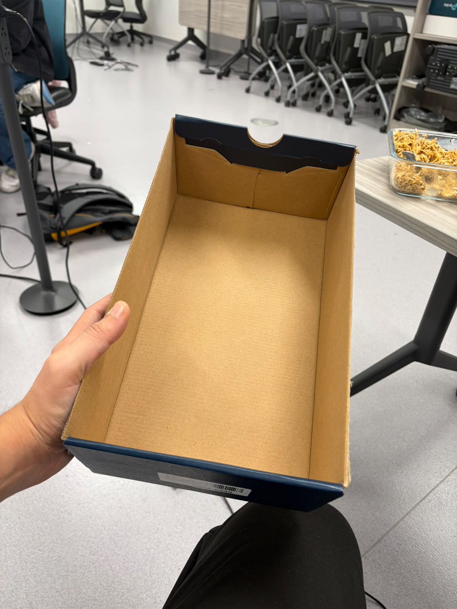 | 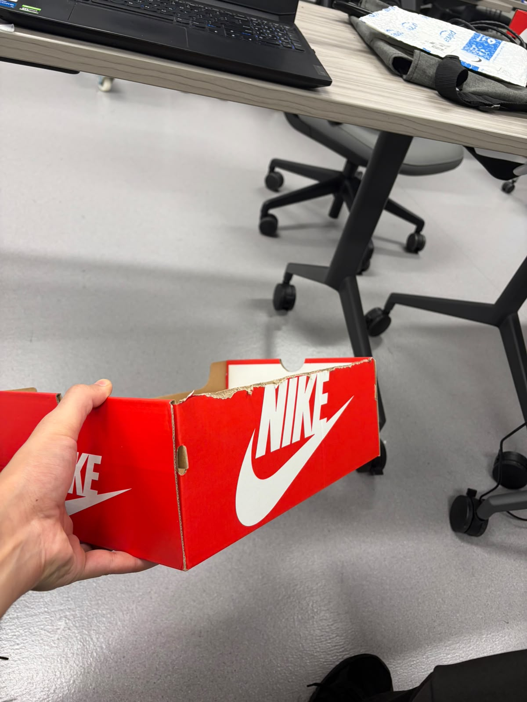 | 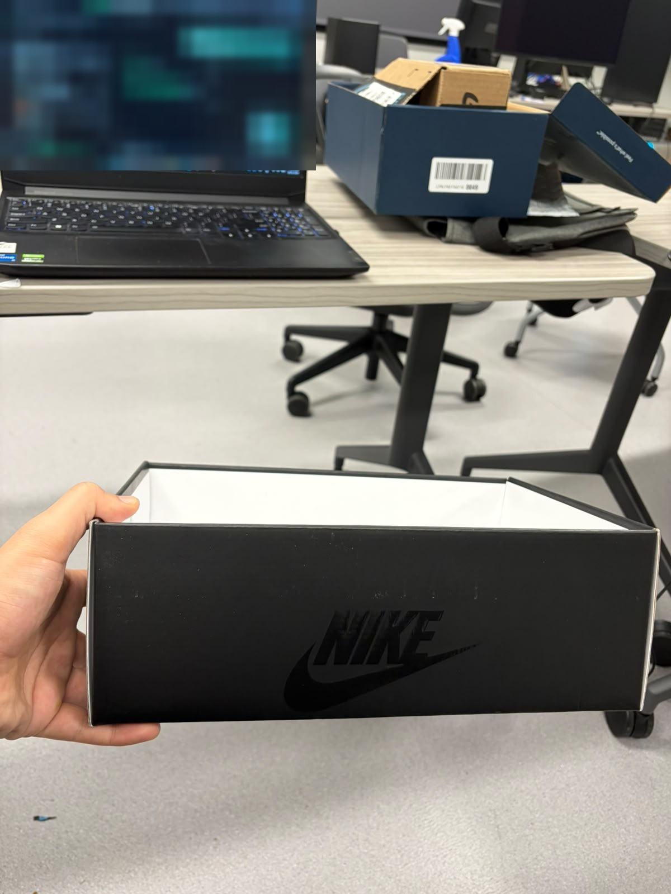 |

## Packages

The G gripper opens 97.5 mm between the fingers, so a package can only be picked across a side narrower than that.

| Package | What | L x W x H (in) | L x W x H (mm) | Role in sim (QR) | Sim id | Arrives as | Gripper |
|---|---|---|---|---|---|---|---|
| 1 | Amazon box, kraft, black seam tape | 9 x 6 x 3.5 | 229 x 152 x 89 | lane A -> blue (`420/95112/001`) | `box_z95112` | standing on its long edge | fits: 89 mm across, ~4 mm spare per finger |
| 2 | Amazon box, kraft, black seam tape | 11 x 8.1 x 4 | 279 x 206 x 102 | lane B -> red (`420/90210/001`) | `box_z90210` | flat, long side across the table | **no**: 102 mm even on edge |
| 3 | Amazon padded mailer (the soft plastic bag parcel), white with blue band | 10 x 8.5 x 0.5 | 254 x 216 x 13 | LL-03, unknown ZIP -> reject (`420/10001/001`), label top or bottom only | `box_z10001` | flat, long side across the table | **no**: 13 mm thick, 216 mm wide |
| 4 | Perfume box, light-blue brushed foil | 6 x 4 x 2 | 152 x 102 x 51 | no label -> reject | `box_garbage` | flat, biggest face down | **no**: 102 mm wide lying flat |

Sim-only props, NOT measured or photographed yet (nominal sizes in `props.py`): `z94110` kraft box 3 x 3 x 3 in (lane A), `z90015` kraft box 3 x 5 x 8 in
(lane B, arrives standing), `z60601` white box 5 x 3.5 x 2.5 in (reject), `z95014` kraft box 12 x 10 x 6 in (lane A, not graspable), `wallet` leather wallet
4.5 x 3.5 x 0.75 in (reject, no label), `plainbox` kraft box 6 x 4 x 3 in (reject, no label). Every labelled parcel carries its one QR label on a random
face per episode (variants `<id>_<face>`, see sim/README.md).

ACTIVE suite (what the user has, the only parcels in the sim cases): Bhindi, IQBAR A, Miro, mailer (package 3), IQBAR B, perfume (package 4), wallet.
Every one lies flat; a label, when present, is on the top or bottom face only (random per episode). The other props above and below stay defined in `props.py`, unused.

Real FLAT retail boxes, measured with a tape measure on a phone (photos not in the repo yet; the sim models them from the numbers and the colours
below). They always arrive lying flat, biggest face down, and carry ONE 100 x 70 mm shipping label on the big top or bottom face (random per episode,
variants `<id>_pz` / `<id>_nz`). All three are wider than the 97.5 mm gripper opening lying flat (parcel_report WARNs, intended): two-arm handling. IQBAR is a stylised brand name.

| Prop | What | L x W x H (in) | L x W x H (mm) | Print | Label (QR) | Sim id / case |
|---|---|---|---|---|---|---|
| Bhindi | Bhindi Masala ready-meal box | 6.5 x 4 x 1.5 | 165 x 102 x 38 | deep purple, orange band at one end, dark food photo on top | LL-08, lane A -> blue (`420/95126/001`) | `bhindi`, case 32 |
| IQBAR A | IQBAR protein bar variety pack | 10.5 x 4 x 2.5 | 267 x 102 x 64 | chocolate brown, dark band | LL-11, lane B -> red (`420/90024/001`) | `iqbar_a`, case 33 |
| IQBAR B | a second IQBAR box, identical geometry and print | 10.5 x 4 x 2.5 | 267 x 102 x 64 | as IQBAR A | NO label -> reject | `iqbar_b`, case 35 |
| Miro | Miro box | 8.5 x 6.5 x 1.5 | 216 x 165 x 38 | black, white logo patch (90 x 45 mm, modelled as a plain rectangle) on top | LL-14, reject -> tray (`420/02139/001`) | `miro`, case 34 |

Not measured yet: weights (the sim guesses 0.10-0.20, 0.15-0.30, 0.05-0.10 and 0.25-0.40 kg) (wallet: sim-only, no label -> reject, case 28; mailer case 20, perfume case 22).
The QR labels are printed from `sim/make_qr_boxes.py` (`docs/labels/`: `sim/make_labels.py`, full shipping labels, 40 mm QR); package 4's own authenticity sticker
also carries a QR code, which the sim does not model.

| Package 1 | Package 2 | Package 3 | Package 4 |
|---|---|---|---|
| 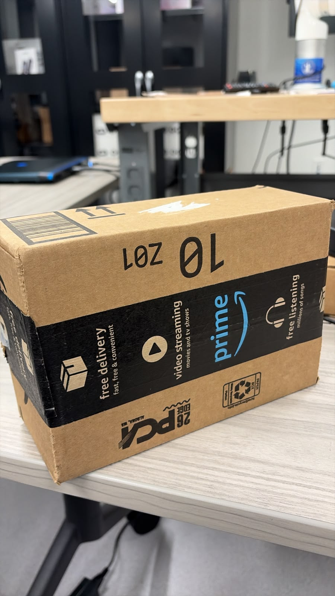 | 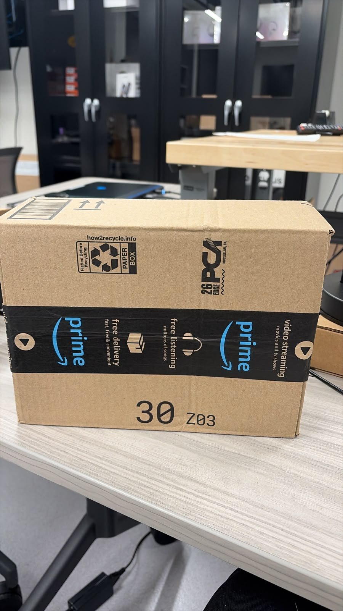 | 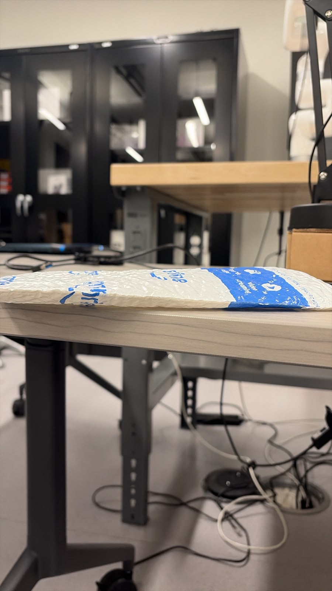 | 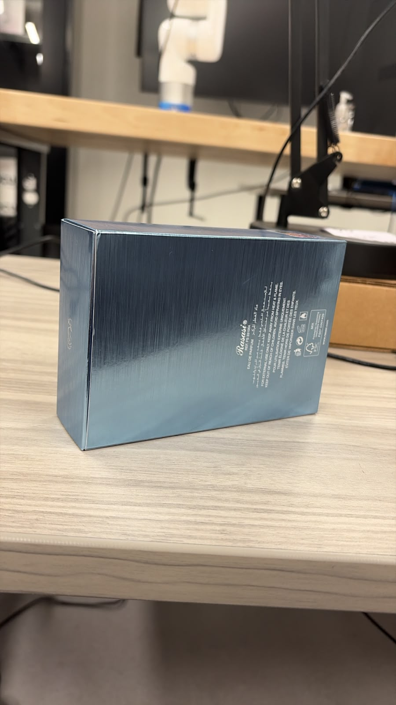 |
| 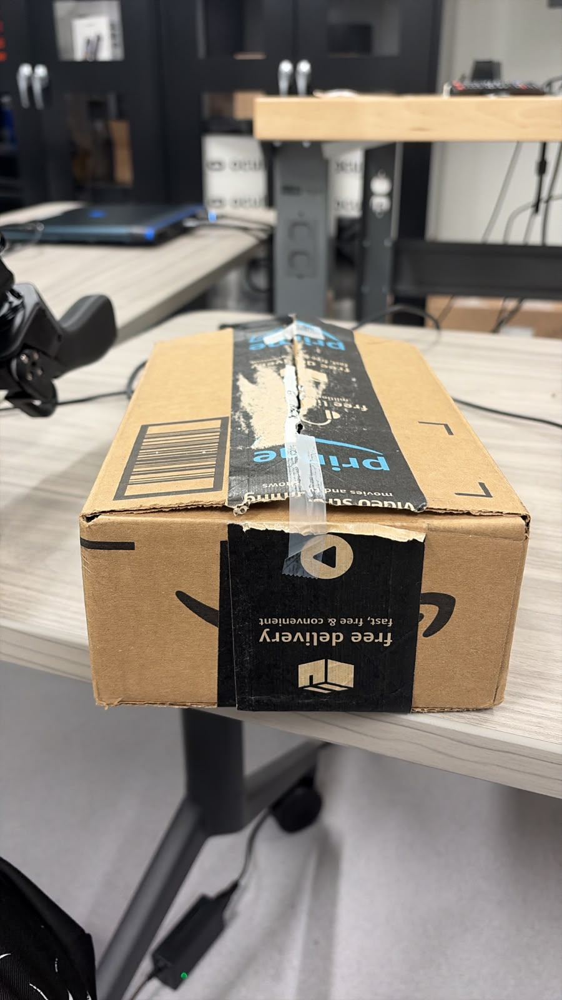 | 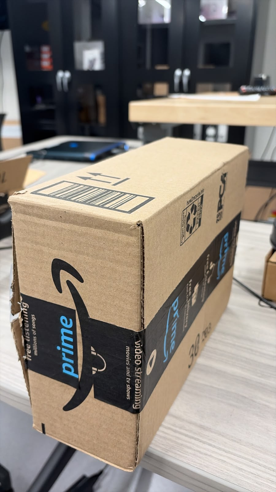 | 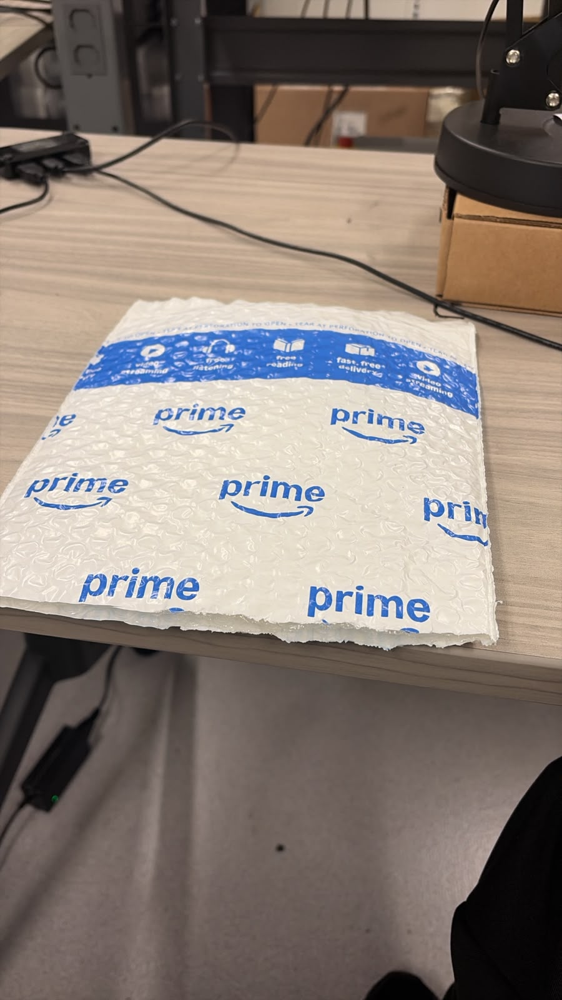 | 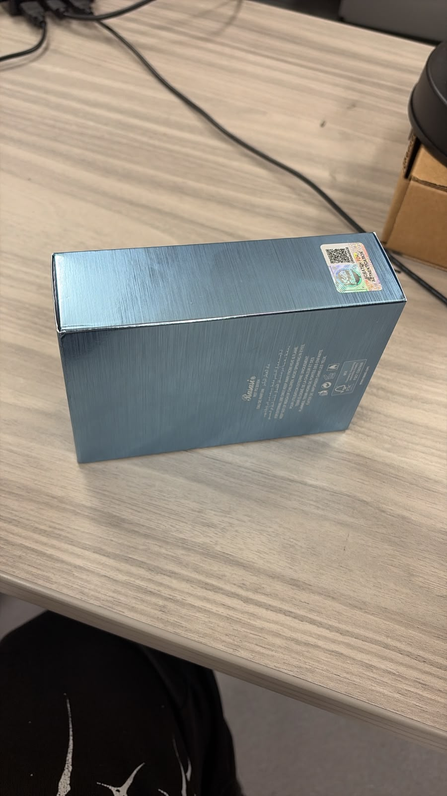 |
| 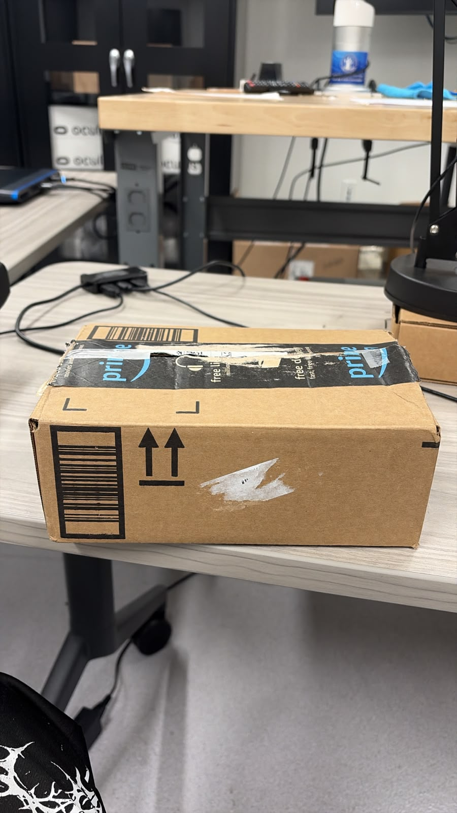 | 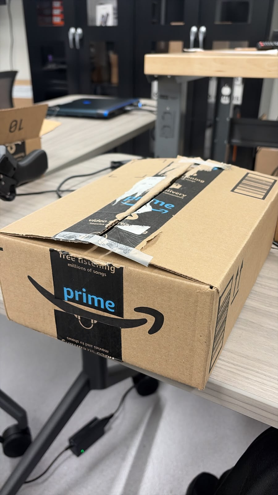 | 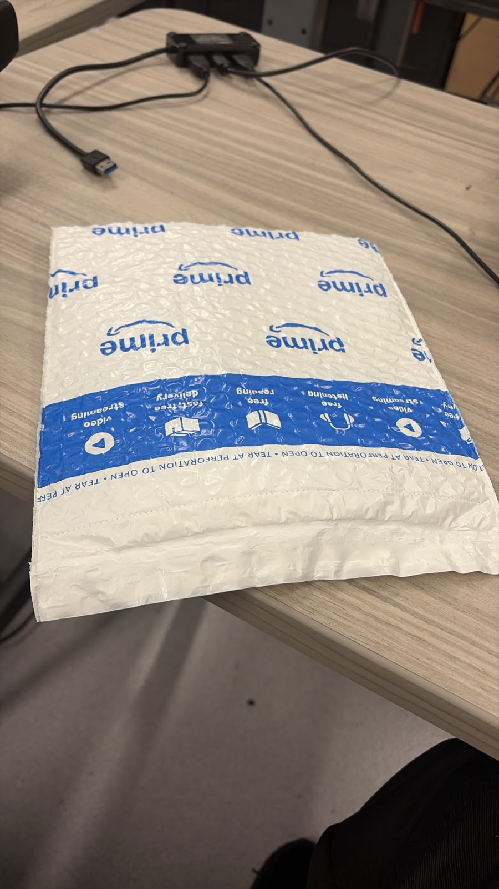 | 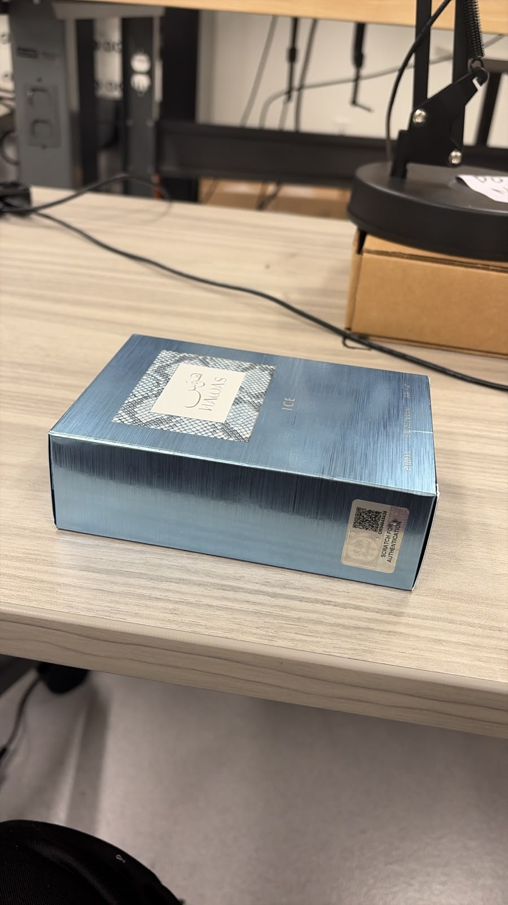 |
